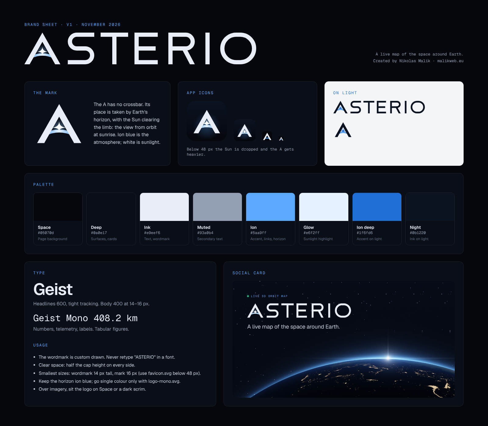

# Asterio brand



## The idea

The A in ASTERIO has no crossbar. Earth's horizon takes its place, and the Sun is just clearing the limb: what you see from orbit at sunrise. Ion blue is the atmosphere, white is sunlight. The rest of the wordmark is drawn as wide, monoline capitals with an 8-unit stroke on a 60-unit cap height, so it stays calm next to the 3D view.

The wordmark is custom drawn. Don't retype "ASTERIO" in a font.

## Files

All served files live in `app/brand/` (and the favicons in `app/`).

| File | Use |
| --- | --- |
| `app/brand/logo.svg` | Wordmark, light, for dark backgrounds (default) |
| `app/brand/logo-dark.svg` | Wordmark for light backgrounds |
| `app/brand/logo-mono.svg` | Single colour, uses `currentColor` |
| `app/brand/mark.svg` / `mark-dark.svg` | The A on its own, transparent |
| `app/brand/icon.svg` | App icon tile (detailed, 48 px and up) |
| `app/favicon.svg` | Favicon tile, simplified for 16 to 32 px |
| `app/favicon.ico` | 16, 32 and 48 px fallback |
| `app/brand/apple-touch-icon.png` | 180 x 180, full bleed |
| `app/brand/icon-192.png`, `icon-512.png` | PWA icons, rounded tile |
| `app/brand/icon-maskable-512.png` | PWA maskable icon (A inside the 80% safe zone) |
| `app/site.webmanifest` | PWA manifest pointing at the icons |
| `app/brand/og-default.png` | Social card, 1200 x 630 |
| `app/brand/og-about.png`, `og-sources.png`, `og-terms.png`, `og-privacy.png`, `og-cookies.png` | Per-page social cards |

The social cards are rendered from the app's own Blue Marble and night-lights textures: Europe at night from orbit, with the Sun rising over the limb.

## Palette

| Name | Hex | Use |
| --- | --- | --- |
| Space | `#05070d` | Page background, icon tile |
| Deep | `#0a0e17` | Surfaces, cards |
| Ink | `#e9eef6` | Text, wordmark |
| Muted | `#93a0b4` | Secondary text |
| Ion | `#5aa9ff` | Accent, links, the horizon |
| Glow | `#e6f2ff` | Sunlight highlight on the horizon |
| Ion deep | `#1f6fd6` | Accent on light backgrounds |
| Night | `#0b1220` | Ink on light backgrounds |
| Live | `#3ddc97` | Live-data status only |

These match the site's existing CSS tokens; nothing in `app/index.html` needs to change.

## Type

- **Geist** for UI and headlines. Headlines at weight 600 with tight tracking (about -0.03em), body at 400, 14 to 16 px.
- **Geist Mono** for numbers, telemetry and labels, with tabular figures. Small uppercase labels are tracked out (about 0.16em).

## Usage

- Clear space: half the cap height on every side of the wordmark.
- Smallest sizes: wordmark 14 px tall (about 100 px wide), mark 16 px. Below 48 px use `favicon.svg`, which drops the Sun and thickens the A.
- In the nav, show the wordmark at 16 to 18 px tall; it replaces both the old icon and the "Asterio" text.
- Keep the horizon ion blue. For one colour, use `logo-mono.svg`.
- Over imagery, put the logo on Space or a dark scrim.

## Regenerating

The SVGs are generated from `brand/src/geom.mjs` (letter geometry) and `brand/src/svgs.mjs`:

```sh
node brand/src/svgs.mjs                     # writes app/brand/*.svg and app/favicon.svg
NODE_PATH=$(npm root -g) node brand/src/og.mjs [default|about|sources|terms|privacy|cookies]
convert brand/src/raw-og-default.png -filter Lanczos -resize 1200x630 -strip app/brand/og-default.png
NODE_PATH=$(npm root -g) node brand/src/rast.mjs app/brand/icon.svg 512 app/brand/icon-512.png
NODE_PATH=$(npm root -g) node brand/src/sheet.mjs brand/brand-sheet.png
```

`og.mjs`, `rast.mjs` and `sheet.mjs` need Playwright with Chromium; the cards render at 2x and are downscaled with ImageMagick. Geist and Geist Mono (SIL Open Font License) are bundled in `brand/src/fonts/` so renders don't depend on the network.

---

Created by Nikolas Malík, [malikweb.eu](https://malikweb.eu).
